# Textos acadêmicos e ordem de inserção

As figuras 18–21 existentes foram preservadas como registro da modelagem anterior. O complemento usa 22–47, sem duplicar a sequência atual. Para consolidação, substituir as figuras superadas e renumerar todas as referências e a lista de ilustrações em uma única revisão editorial. A arquitetura destina-se ao capítulo de tecnologias (VII no Draw Code); esse capítulo ainda não aparece no texto atual da cópia de trabalho.

## Figura 22 – Casos de uso: visão geral

Destino: capítulo IV. Arquivo: `01a-casos-geral`.

A figura apresenta as responsabilidades dos atores no recorte indicado do CourtTime. As operações pertencem à solução final pretendida, cujo estágio de implementação é discriminado no relatório.

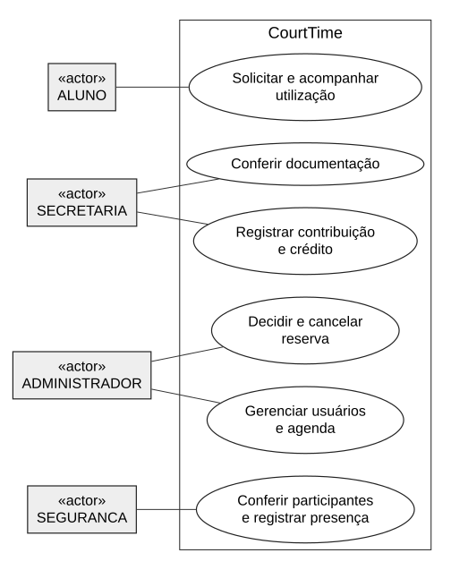

Fonte: Elaborado pelos autores (2026).

O aluno inicia e acompanha o pedido; a secretaria realiza a conferência e o registro financeiro; a administração decide sobre o uso; e a segurança atua na portaria. Crédito e registro de presença ainda são planejados na base analisada. Os diagramas seguintes detalham estas finalidades sem conceder competências entre perfis.

Situação: Modelo final planejado; consultar situação de implementação no relatório.

## Figura 23 – Casos de uso: acesso e consulta

Destino: capítulo IV. Arquivo: `01b-casos-acesso`.

A figura apresenta as responsabilidades dos atores no recorte indicado do CourtTime. As operações pertencem à solução final pretendida, cujo estágio de implementação é discriminado no relatório.

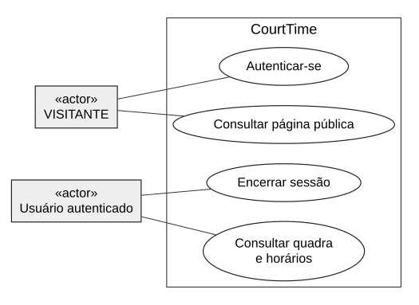

Fonte: Elaborado pelos autores (2026).

Usuário autenticado é uma abstração dos quatro perfis, sem criar um quinto valor em Perfil. A consulta do calendário exige autenticação na base verificada; o visitante acessa apenas a página pública e o login. As demais operações exigem autorização específica.

Situação: Modelo final planejado; consultar situação de implementação no relatório.

## Figura 24 – Casos de uso: solicitação pelo aluno

Destino: capítulo IV. Arquivo: `01c-casos-aluno`.

A figura apresenta as responsabilidades dos atores no recorte indicado do CourtTime. As operações pertencem à solução final pretendida, cujo estágio de implementação é discriminado no relatório.

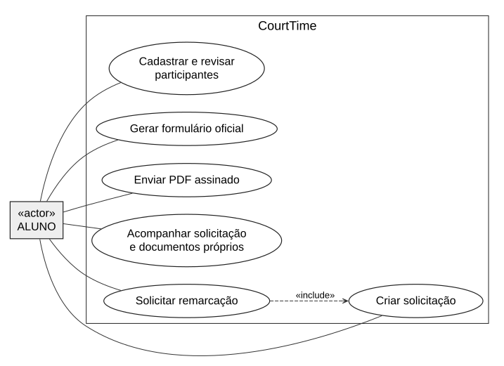

Fonte: Elaborado pelos autores (2026).

A remarcação inclui a criação de uma nova solicitação. O aluno escolhe se copia os participantes; o novo pedido exige novo documento e aprovação. A assinatura gov.br ocorre fora da fronteira do sistema. O mínimo é de dez ALUNOS, e não dez participantes de qualquer categoria.

Situação: Modelo final planejado; consultar situação de implementação no relatório.

## Figura 25 – Casos de uso: secretaria e administração

Destino: capítulo IV. Arquivo: `01d-casos-instituicao`.

A figura apresenta as responsabilidades dos atores no recorte indicado do CourtTime. As operações pertencem à solução final pretendida, cujo estágio de implementação é discriminado no relatório.

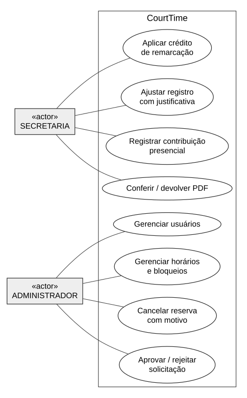

Fonte: Elaborado pelos autores (2026).

A conferência da assinatura é humana, com uso externo do ITI. O registro presencial não aprova a solicitação. A decisão administrativa reconfere conflitos e elegibilidade. O cancelamento conserva as evidências; a comunicação por WhatsApp é manual. Aplicar crédito é uma evolução planejada de R04.

Situação: Modelo final planejado; consultar situação de implementação no relatório.

## Figura 26 – Casos de uso: presença e consulta administrativa

Destino: capítulo IV. Arquivo: `01e-casos-portaria`.

A figura apresenta as responsabilidades dos atores no recorte indicado do CourtTime. As operações pertencem à solução final pretendida, cujo estágio de implementação é discriminado no relatório.

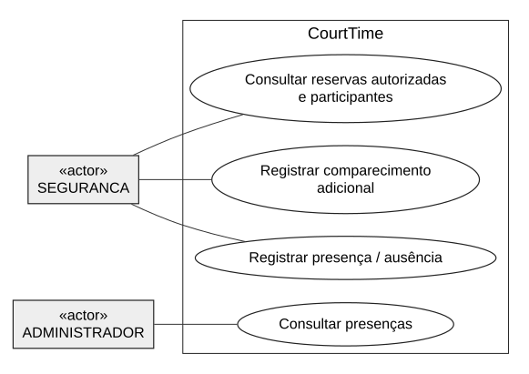

Fonte: Elaborado pelos autores (2026).

A consulta de autorizações já existe. As escritas de presença e o registro adicional são planejados. Registrar uma pessoa extra não concede entrada; o responsável por autorizar e o modo de registrar essa autorização aguardam D3. A segurança não recebe acesso a PDFs, contribuições ou decisões administrativas.

Situação: Modelo final planejado; consultar situação de implementação no relatório.

## Figura 27 – Atividades: criação e participantes

Destino: capítulo IV. Arquivo: `04a-atividade-solicitacao`.

O fluxo inicia com a seleção de um período de uma hora e a criação de uma solicitação preliminar. A preparação do documento depende da lista de participantes.

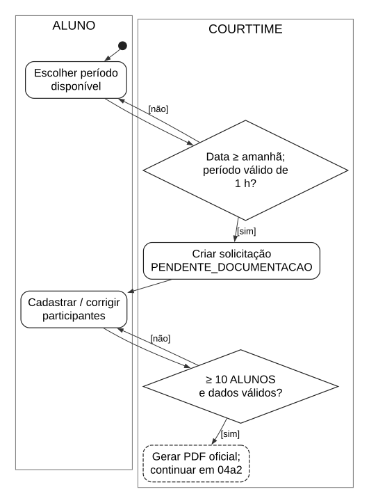

Fonte: Elaborado pelos autores (2026).

A guarda do dia anterior representa R01 e o PR #70; não se inventa horário como 17h. O prazo vale também para correções. A assinatura é externa. O upload valida formato técnico, autorização e versão, sem comprovar autenticidade criptográfica. A indicação de mínimo antes da geração é uma regra final do fluxo.

Situação: Modelo final planejado; consultar situação de implementação no relatório.

## Figura 28 – Atividades: assinatura e envio

Destino: capítulo IV. Arquivo: `04a2-atividade-envio`.

O fluxo inicia com a seleção de um período de uma hora e a criação de uma solicitação preliminar. A preparação do documento depende da lista de participantes.

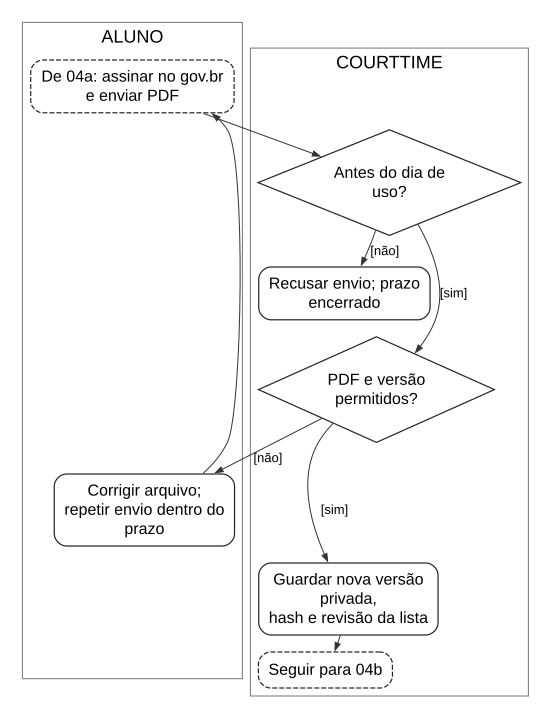

Fonte: Elaborado pelos autores (2026).

A guarda do dia anterior representa R01 e o PR #70; não se inventa horário como 17h. O prazo vale também para correções. A assinatura é externa. O upload valida formato técnico, autorização e versão, sem comprovar autenticidade criptográfica. A indicação de mínimo antes da geração é uma regra final do fluxo.

Situação: Modelo final planejado; consultar situação de implementação no relatório.

## Figura 29 – Atividades: conferência e contribuição

Destino: capítulo IV. Arquivo: `04b-atividade-conferencia`.

A secretaria decide se a versão mais recente atende às exigências documentais. A conferência humana é registrada independentemente da autorização de uso.

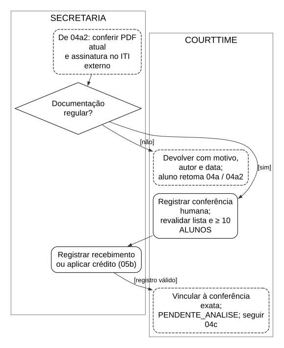

Fonte: Elaborado pelos autores (2026).

R07 acrescenta a confirmação explícita de conferência gov.br. A devolução mantém o histórico e só permite reenvio dentro do prazo. A contribuição de R$ 2,00 por participante por hora é presencial; o crédito segue o fluxo específico. Falhas de revisão ou autorização recusam a operação sem avançar o estado.

Situação: Modelo final planejado; consultar situação de implementação no relatório.

## Figura 30 – Atividades: decisão administrativa

Destino: capítulo IV. Arquivo: `04c-atividade-aprovacao`.

A análise administrativa é uma decisão humana, complementada por revalidações transacionais na tentativa de aprovação.

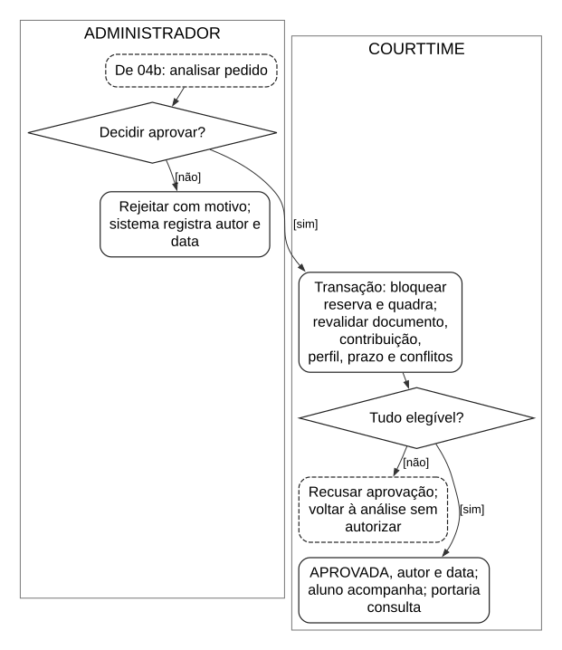

Fonte: Elaborado pelos autores (2026).

Solicitações preliminares podem disputar o mesmo horário: somente a aprovação autoriza e ocupa a agenda. O bloqueio pessimista da quadra serializa aprovações e alterações conflitantes. A rejeição exige justificativa. A aprovação é permitida no dia do uso, desde que o período ainda não tenha começado.

Situação: Modelo final planejado; consultar situação de implementação no relatório.

## Figura 31 – Atividades: cancelamento institucional

Destino: capítulo IV. Arquivo: `05a-atividade-cancelamento`.

O cancelamento institucional registra o motivo e conserva a aprovação anterior e as evidências. A remarcação depende de nova iniciativa do aluno.

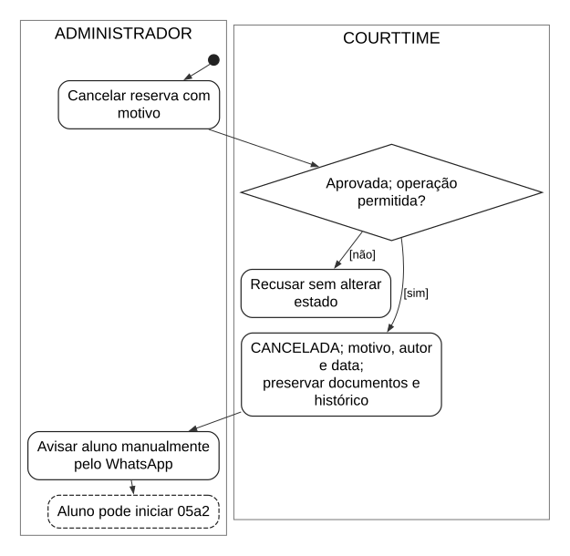

Fonte: Elaborado pelos autores (2026).

O contato por WhatsApp é uma ação humana, sem API. A origem é bloqueada durante a criação; a unicidade impede duas sucessoras. O aluno pode copiar os participantes, mas deve revisar a lista e obter novo documento. Falha de prazo ou disponibilidade recusa a nova solicitação.

Situação: Modelo final planejado; consultar situação de implementação no relatório.

## Figura 32 – Atividades: criação da remarcação

Destino: capítulo IV. Arquivo: `05a2-atividade-remarcacao`.

O cancelamento institucional registra o motivo e conserva a aprovação anterior e as evidências. A remarcação depende de nova iniciativa do aluno.

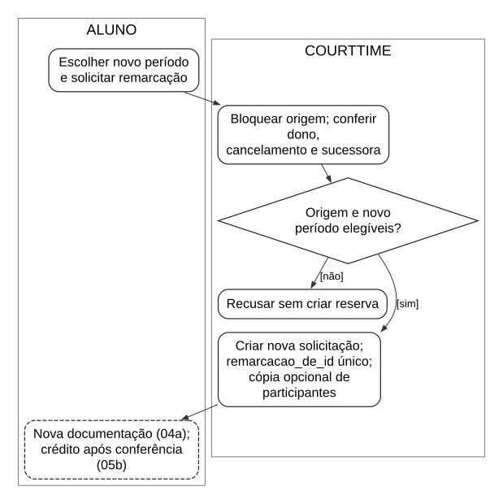

Fonte: Elaborado pelos autores (2026).

O contato por WhatsApp é uma ação humana, sem API. A origem é bloqueada durante a criação; a unicidade impede duas sucessoras. O aluno pode copiar os participantes, mas deve revisar a lista e obter novo documento. Falha de prazo ou disponibilidade recusa a nova solicitação.

Situação: Modelo final planejado; consultar situação de implementação no relatório.

## Figura 33 – Atividades: cálculo e aplicação de crédito

Destino: capítulo IV. Arquivo: `05b-atividade-credito`.

O aproveitamento financeiro é parte da versão final planejada. O cálculo não dispensa documentos nem substitui a análise administrativa.

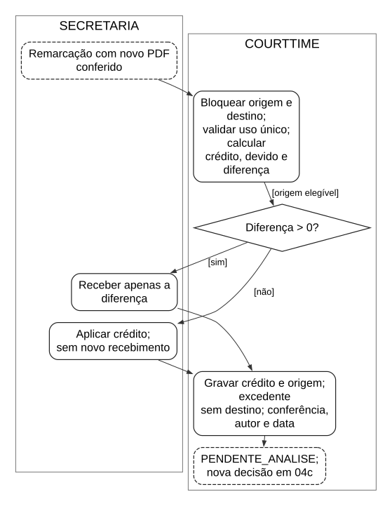

Fonte: Elaborado pelos autores (2026).

A implementação deve serializar aplicação e ajuste da contribuição de origem; repetição ou disputa é recusada com rollback. O excedente fica registrado sem destino enquanto D2 estiver aberta. Nenhum novo recebimento ocorre quando a diferença é zero. Se a análise rejeitar, não se presume liberação, reembolso ou novo uso: a regra não está definida. C = valor da origem após ajustes + crédito aplicado anteriormente; D = 2,00 × participantes × 1 h; diferença = máx(D − C, 0); aplicado = mín(C, D); excedente = máx(C − D, 0).

Situação: Modelo final planejado; consultar situação de implementação no relatório.

## Figura 34 – Atividades: consulta e identificação

Destino: capítulo IV. Arquivo: `06-atividade-presenca`.

A segurança consulta as reservas autorizadas e, na evolução planejada, registra presenças, ausências e comparecimentos adicionais.

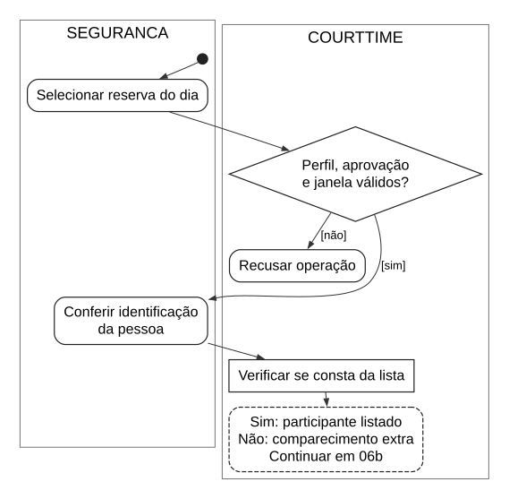

Fonte: Elaborado pelos autores (2026).

Ausência de marcação permanece não registrada, não equivale a AUSENTE. A janela apenas no dia é proposta técnica ainda pendente. D3 impede presumir quem autoriza a pessoa extra: até a definição, não há autorização automática. A segurança não acessa PDFs, pagamentos, horários administrativos ou aprovação.

Situação: Modelo final planejado; consultar situação de implementação no relatório.

## Figura 35 – Atividades: registro de presença

Destino: capítulo IV. Arquivo: `06b-atividade-registro`.

A segurança consulta as reservas autorizadas e, na evolução planejada, registra presenças, ausências e comparecimentos adicionais.

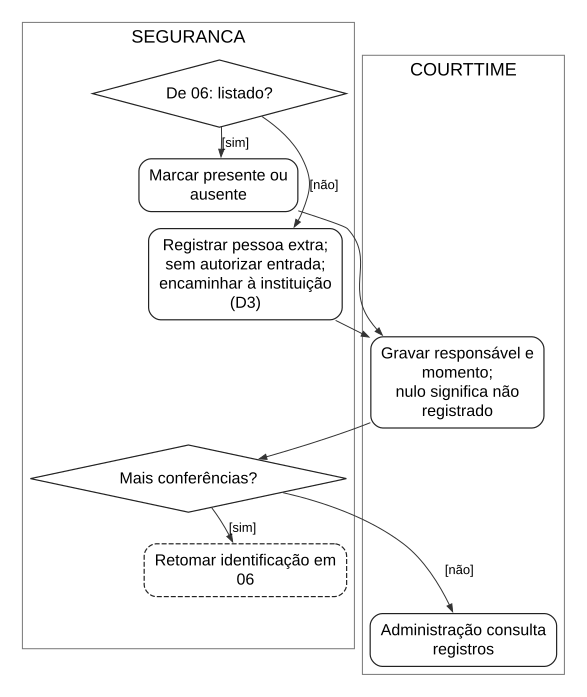

Fonte: Elaborado pelos autores (2026).

Ausência de marcação permanece não registrada, não equivale a AUSENTE. A janela apenas no dia é proposta técnica ainda pendente. D3 impede presumir quem autoriza a pessoa extra: até a definição, não há autorização automática. A segurança não acessa PDFs, pagamentos, horários administrativos ou aprovação.

Situação: Modelo final planejado; consultar situação de implementação no relatório.

## Figura 36 – Classes: núcleo de reservas

Destino: capítulo V. Arquivo: `02a-classes-reservas`.

O núcleo relaciona a solicitação a um usuário e à quadra. A lista de participantes constitui informação do pedido e não uma coleção de contas de acesso.

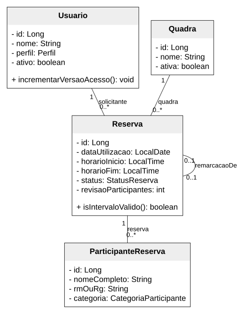

Fonte: Elaborado pelos autores (2026).

Cada reserva possui um solicitante e uma quadra; pode ainda não ter participantes durante o preenchimento. A autorrelação remarcacaoDe é opcional e única: uma cancelada admite no máximo uma sucessora. Associações simples não pressupõem exclusão em cascata.

Situação: IMPLEMENTADO em 7b40dcb; atributos selecionados.

## Figura 37 – Classes: agenda da quadra

Destino: capítulo V. Arquivo: `02b-classes-agenda`.

A disponibilidade é formada por intervalos semanais, aos quais se aplicam bloqueios de datas específicas e reservas aprovadas.

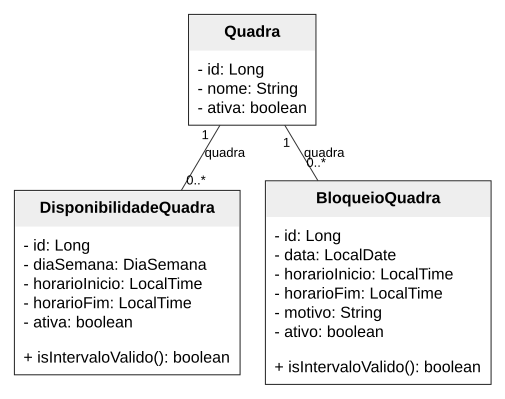

Fonte: Elaborado pelos autores (2026).

Os dois tipos de intervalo pertencem a uma quadra. O calendário divide a grade em períodos de uma hora. Os métodos de intervalo verificam a ordem dos horários, enquanto a prevenção de conflitos depende também dos serviços e das transações.

Situação: IMPLEMENTADO em 7b40dcb.

## Figura 38 – Classes: documentos e contribuição

Destino: capítulo V. Arquivo: `02c-classes-documentacao`.

A documentação enviada possui versões independentes. A conferência humana e a contribuição estão vinculadas a registros específicos para permitir a rastreabilidade.

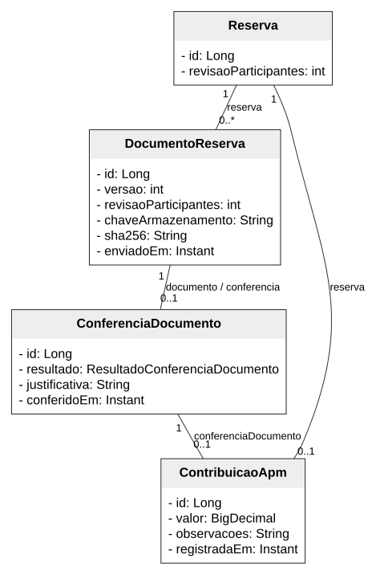

Fonte: Elaborado pelos autores (2026).

Cada documento admite no máximo uma conferência. Uma contribuição referencia exatamente uma reserva e uma conferência, com unicidade em ambos os vínculos. O hash representa integridade dos bytes, sem validar a assinatura. As associações dos operadores são detalhadas no dicionário.

Situação: IMPLEMENTADO em 7b40dcb; operadores detalhados no dicionário.

## Figura 39 – Classes: auditoria e ajustes

Destino: capítulo V. Arquivo: `02d-classes-auditoria`.

O modelo distingue a auditoria de contas dos ajustes de contribuição. Cada registro preserva o operador e o momento da alteração.

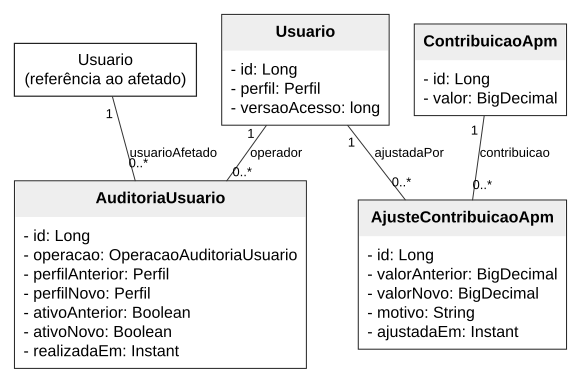

Fonte: Elaborado pelos autores (2026).

AuditoriaUsuario não é um log genérico de todos os eventos. As decisões da reserva ficam na própria Reserva; os ajustes mantêm antes, depois e motivo. O dicionário registra também as observações anteriores e novas.

Situação: IMPLEMENTADO em 7b40dcb.

## Figura 40 – Classes: extensões da versão final

Destino: capítulo V. Arquivo: `02e-classes-extensoes`.

As estruturas desta figura complementam o modelo implementado, seguindo as etapas do plano institucional. Os atributos são propostas ou alterações ainda não integradas.

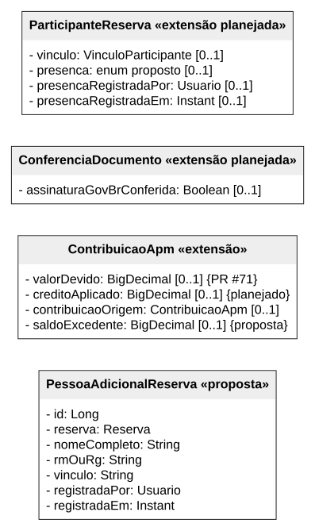

Fonte: Elaborado pelos autores (2026).

Não são criadas classes Crédito e Remarcação: o crédito estende ContribuicaoApm e a remarcação usa Reserva.remarcacaoDe. PessoaAdicionalReserva é nome proposto, condicionado a D3. saldoExcedente explicita uma lacuna do plano. As multiplicidades entre colchetes indicam valores opcionais, sem atribuir anotação JPA a estruturas ainda não implementadas.

Situação: PLANEJADO, exceto valorDevido EM DESENVOLVIMENTO no PR #71.

## Figura 41 – Enumerações do domínio

Destino: capítulo V. Arquivo: `02f-enumeracoes`.

As enumerações delimitam os perfis, situações e categorias usados pelas entidades persistidas.

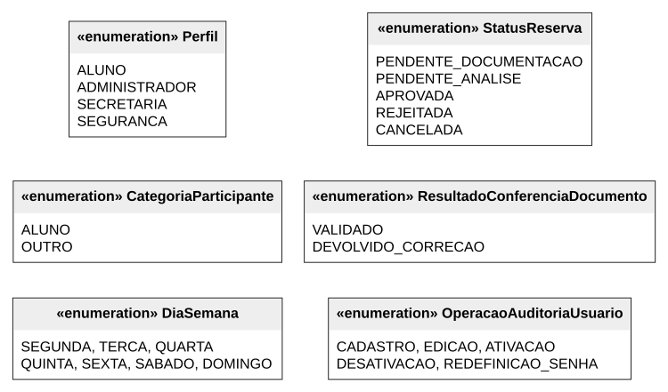

Fonte: Elaborado pelos autores (2026).

Os nomes reproduzem o Java. Os vínculos de OUTRO e os estados de presença pertencem à extensão planejada: o plano usa PRESENTE, AUSENTE e nulo para não registrado; a lista provisória de vínculos exige reconciliação com o termo oficial.

Situação: IMPLEMENTADO em 7b40dcb.

## Figura 42 – DER lógico-relacional: reservas

Destino: capítulo V. Arquivo: `03a-der-reservas`.

O DER foi derivado dos mapeamentos JPA da base verificada. Ele expressa as chaves e as cardinalidades relacionais sem presumir introspecção de um banco em produção.

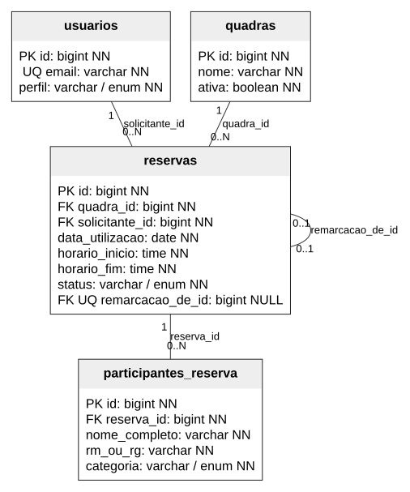

Fonte: Elaborado pelos autores (2026).

PK identifica chave primária; FK, referência; UQ, unicidade; NN, campo obrigatório. A unicidade de remarcacao_de_id admite valores nulos. Não há UQ composto de reserva e RM/RG: a não duplicação é uma validação do serviço, executada com bloqueio da reserva.

Situação: IMPLEMENTADO em JPA; tipos físicos esperados, não inspecionados em banco vivo.

## Figura 43 – DER lógico-relacional: agenda

Destino: capítulo V. Arquivo: `03b-der-agenda`.

As tabelas de agenda armazenam faixas semanais e bloqueios específicos. Ambas referenciam a quadra.

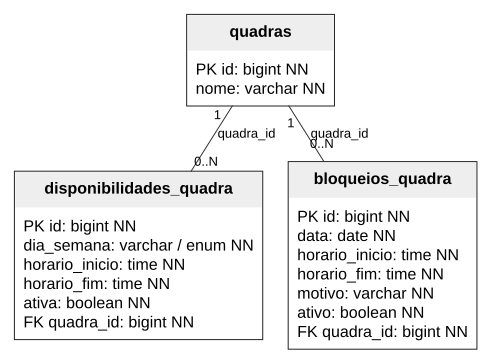

Fonte: Elaborado pelos autores (2026).

Não existe constraint SQL de exclusão de sobreposição demonstrada nesta base. As regras de conflitos são protegidas por consultas e bloqueios pessimistas nos serviços. Portanto, uma ligação no DER não representa, isoladamente, prevenção de reservas conflitantes.

Situação: IMPLEMENTADO em JPA; esquema gerenciado por Hibernate update.

## Figura 44 – DER lógico-relacional: documentos e APM

Destino: capítulo V. Arquivo: `03c-der-documentos`.

As versões dos documentos e os registros da secretaria mantêm referências obrigatórias ao contexto de origem.

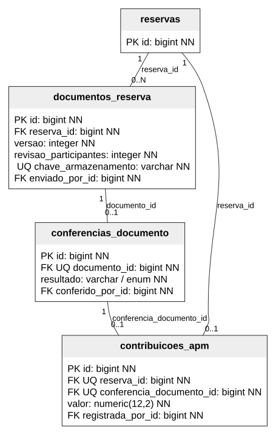

Fonte: Elaborado pelos autores (2026).

Há UQ composto em documentos_reserva(reserva_id, versao), UQ em chave_armazenamento e documento_id, e UQ em cada vínculo de contribuicoes_apm com reserva e conferência. enviado_por_id, conferido_por_id e registrada_por_id referenciam usuarios(id), conforme o inventário completo.

Situação: IMPLEMENTADO em JPA; operadores estão no inventário.

## Figura 45 – DER lógico-relacional: rastreabilidade

Destino: capítulo V. Arquivo: `03d-der-auditoria`.

A rastreabilidade usa registros de auditoria de usuários e de ajustes financeiros, sem sobrescrever os valores históricos do evento.

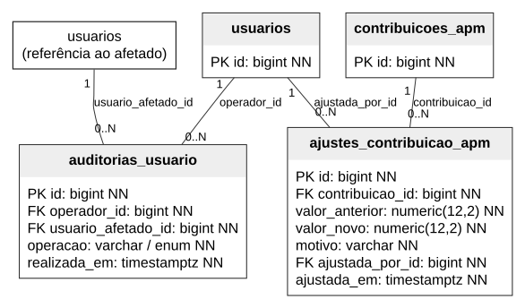

Fonte: Elaborado pelos autores (2026).

Cada ajuste referencia uma contribuição e um operador. Cada auditoria referencia um operador e um usuário afetado. O mapeamento não estabelece exclusão em cascata. As contas são desativadas logicamente para preservar essas referências.

Situação: IMPLEMENTADO em JPA.

## Figura 46 – DER: alterações propostas para a versão final

Destino: capítulo V. Arquivo: `03e-der-extensoes`.

As alterações são apresentadas em separado para não confundir o esquema existente com a evolução prevista. Campos novos aceitam nulo para distinguir registros legados.

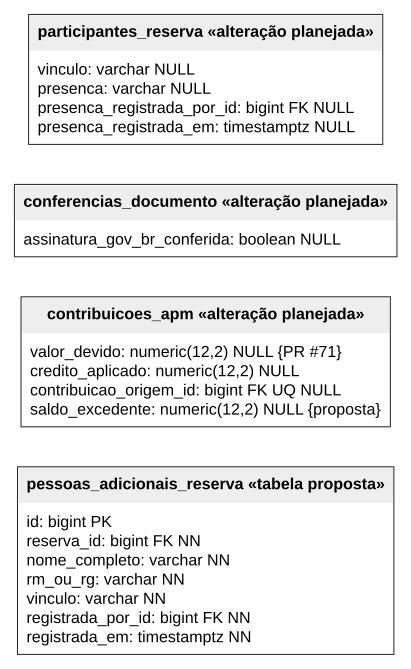

Fonte: Elaborado pelos autores (2026).

As FKs de operadores apontam para usuarios(id); reserva_id aponta para reservas(id); contribuicao_origem_id aponta para contribuicoes_apm(id). A UQ nesta última FK e saldo_excedente são propostas técnicas adicionais ao plano. Relação de origem financeira: zero ou uma origem e no máximo um uso direto. A tabela de adicionais depende de D3.

Situação: PLANEJADO; nomes SQL novos e restrições são propostas, exceto valor_devido no PR #71.

## Figura 47 – Arquitetura do CourtTime

Destino: capítulo VII. Arquivo: `07-arquitetura`.

A aplicação utiliza renderização de páginas no servidor e organiza o processamento em controllers, serviços e repositórios.

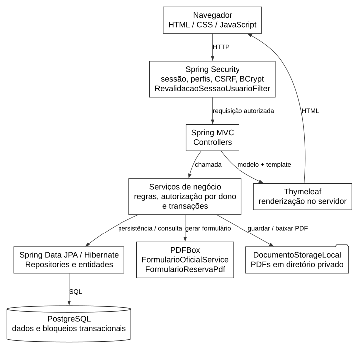

Fonte: Elaborado pelos autores (2026).

O navegador envia requisições submetidas ao Spring Security. Os serviços aplicam regras e transações; JPA/Hibernate acessa o PostgreSQL. PDFBox preenche o formulário oficial. Arquivos assinados ficam no diretório privado e são servidos após autorização. gov.br, ITI e WhatsApp são usos humanos externos, sem integrações automáticas. Não há Flyway nesta base.

Situação: IMPLEMENTADO em 7b40dcb; sem integração externa automática.
